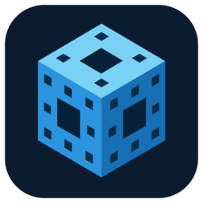

# MengerVibes



Explorador de fractales 3D en tiempo real para Windows, desarrollado en Rust con wgpu. Puedes volar por el interior de una esponja de Menger, combinar fórmulas fractales y exportar tus renders en PNG.

Es un proyecto experimental desarrollado mediante *vibe coding*, con la ayuda de OpenAI.

## Qué puedes hacer

- Explorar ocho fórmulas: Menger, Mandelbulb, Mandelbox, KIFS, Amazing Surface, Pseudo-Kleinian, Sierpinski y Four-Branch Knot.
- Ajustar los parámetros de cada fórmula y combinar varias mediante mutaciones.
- Iluminar la escena con HDRI tanto en Path Traced como en Ambient + AO, y combinarlo con una luz direccional.
- Elegir entre los materiales Diffuse, Standard y Matcap, y ajustar niebla, exposición y profundidad de campo.
- Guardar configuraciones en una galería de presets con miniaturas y recuperar los ajustes de arranque con **Reset to Defaults**.
- Renderizar a una resolución independiente del visor y guardar el resultado en `renders/`.
- Reducir el ruido del visor y de los renders PNG con Open Image Denoise por CPU o GPU.

## Windows x64

Extrae el ZIP de la release y abre mengervibes.exe. Puedes consultar los cambios en [CHANGELOG.md](CHANGELOG.md).

## Compilar y ejecutar en Windows

Necesitas Rust estable con Cargo, las herramientas de compilación de C++ de Visual Studio y el SDK de Windows. Desde la raíz del repositorio, ejecuta:

```powershell
cargo run --release --locked
```

El ejecutable queda en `target/release/mengervibes.exe`.

### Open Image Denoise (opcional)

Descarga el paquete oficial para Windows x64 de [Open Image Denoise 2.x](https://github.com/OpenImageDenoise/oidn/releases) y extrae su contenido en una carpeta `oidn` junto al ejecutable. La biblioteca debe quedar en `oidn/bin/OpenImageDenoise.dll`. Puedes elegir el denoiser del visor y el del render PNG por separado.

## Controles básicos

| Control | Acción |
| --- | --- |
| W / S | Avanzar o retroceder |
| A / D | Desplazarse lateralmente |
| Q / E | Bajar o subir |
| Botón derecho del ratón + movimiento | Orientar la cámara |
| R | Restablecer la cámara |

## Licencia

GNU General Public License v3.0 (GPL-3.0-only). El texto completo está en [COPYING](COPYING).
